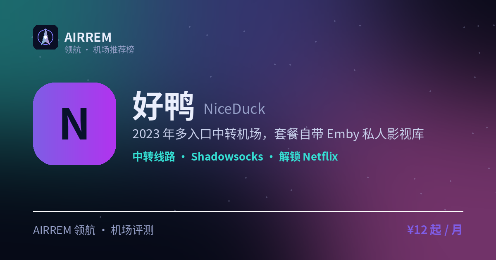

# 好鸭机场怎么样？2026 实测：追剧兼解锁

> **好鸭** 适合谁？追剧 + 解锁，还想要 Emby。2023 年多入口中转机场，套餐自带 Emby 私人影视库

👉 **[好鸭 官网注册入口](https://i.rtxk.us/i/nu95jmp)** ｜ [完整评测与横向对比](https://555736.xyz/niceduck/)

---

## 我们的结论

多入口中转国内接入较友好，绑定 Emby 影视库是差异化卖点，暂未见大规模跑路；协议仅 SS，仍建议先月付验证。

## 基本信息

| 项目 | 内容 |
| --- | --- |
| 机场名称 | 好鸭（好鸭云） |
| 成立时间 | 2023 |
| 线路类型 | 多入口隧道中转 |
| 支持协议 | Shadowsocks |
| 流媒体解锁 | Netflix / Disney+ / YouTube / ChatGPT / Emby 影视库 |
| 节点地区 | 香港 · 日本 · 台湾 · 新加坡 · 美国 · 韩国 · 澳门 等 |
| 计费方式 | 包月 / 包季 / 包年 |
| 起步价格 | ¥12 / 月 |
| 推荐场景 | 追剧 + 解锁，还想要 Emby |
| Emby 影音 | 支持 |

## 好鸭 套餐价格

| 套餐 | 价格 | 说明 |
| --- | --- | --- |
| 小小鸭 | ¥12 | 100GB/月；季¥36/年¥120 |
| 小鸭 | ¥24 | 200GB/月 |
| 中鸭 | ¥32 | 300GB/月 |
| 大鸭 | ¥52 | 500GB/月 |

> 价格来自官方 GitHub 镜像仓库，随时变动，以官网为准。

## 好鸭 NiceDuck 是什么

好鸭（NiceDuck）成立于 2023 年 9 月，是多入口隧道中转机场，国内设多个入口就近接入，定位性价比中转小机场。

## 线路 · 协议 · 解锁

覆盖港日台新美韩澳门等地区，多入口提升国内不同网络的接入体验；协议仅 SS（成熟稳定），官方称解锁 Netflix/Disney+/YouTube/ChatGPT，套餐通常附带 Emby 私人影视库（与订阅绑定）。

- 多入口隧道中转
- 协议：仅 Shadowsocks
- 套餐附赠 Emby 影视库

> 💡 Emby 属增值内容，非核心功能，按需考虑。

## 优点与缺点

**✅ 优点**

- 多入口，国内接入体验较友好
- 套餐送 Emby 影视库，性价比高
- 暂未见大规模跑路
- SS 成熟稳定、兼容性好

**⚠️ 缺点**

- 协议单一，仅支持 SS
- Emby 与订阅强绑定，到期即停
- 机场行业存在跑路风险，建议先用月付或小额套餐验证稳定性，别一上来就大额年付。

## 适合谁 / 不适合谁

| 👍 适合 | 👎 不适合 |
| --- | --- |
| 想机场顺带解决观影需求 | 需要 Trojan/Hysteria2/VLESS 的用户 |
| 偏好稳定协议、不折腾 |  |

## 常见问题

**Q：Emby 怎么用？**

A：购买套餐后获得 Emby 访问权限，与订阅周期绑定，续费恢复、到期停用。

**Q：好鸭可靠吗？**

A：暂未见大规模跑路，但仍建议先月付验证，避免长期预付。

## 同类机场推荐

拿不定主意？可以再看看这几家同类型的：

- **[守候](https://555736.xyz/shouhou/)** — 稳健老用户 / Emby 影音，¥15 起
- **[自由猫](https://555736.xyz/freecat/)** — 日常主力，¥6 起
- **[淘气兔](https://555736.xyz/taoqitu/)** — 联通移动用户，¥7.8 起

全部 38 家机场的横向对比与选购方法论：**[信号塔 SignalTower · 机场大全](https://555736.xyz/airports/)**

---

数据更新：2026-07 ｜ 价格、套餐与优惠码以官网实时为准 ｜ 本仓库为第三方评测整理，与 好鸭 官方无隶属关系 ｜ 请遵守当地法律法规使用网络服务。

关键词：好鸭、NiceDuck、好鸭云、Emby机场、中转机场、机场推荐
